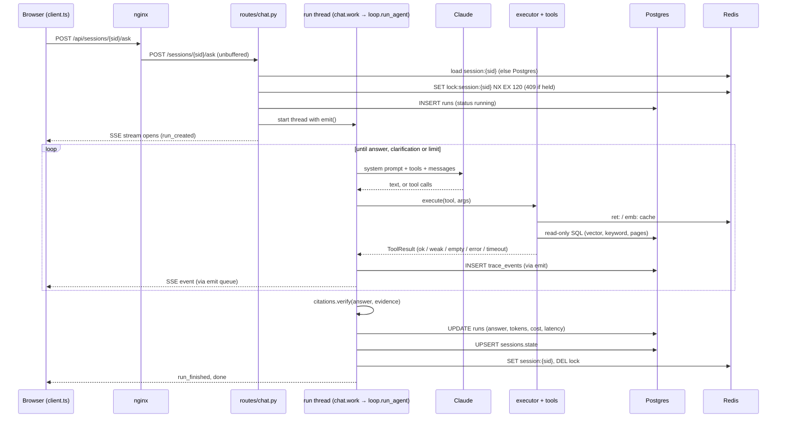
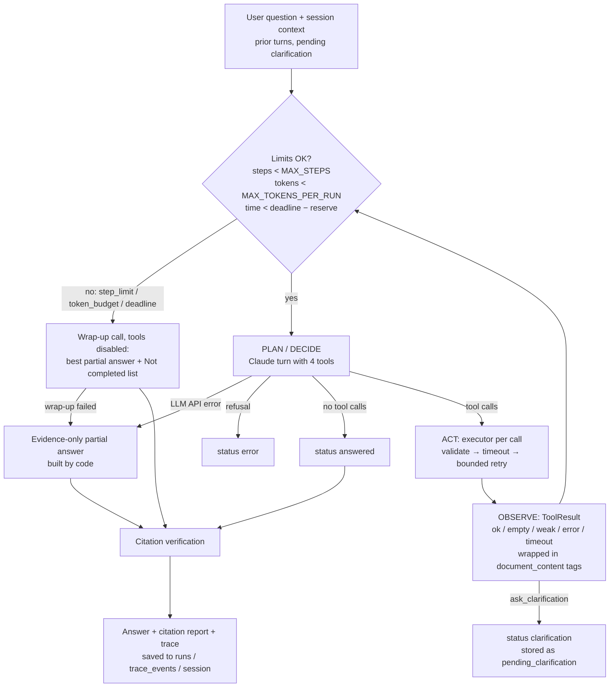

# Architecture


## Components

| Component | Tech | Responsibility |
|---|---|---|
| **web** | React + Vite + TypeScript + Tailwind, served by unprivileged nginx (:8080) | Upload, chat, citation chips, clarification buttons, live execution trace. nginx proxies `/api/*` to the API, so the browser has one origin. |
| **api** | FastAPI (Python 3.12, uv) | REST + Server-Sent Events. Ingest pipeline, hybrid retrieval, the agent loop, the baseline, sessions, run/trace persistence. |
| **Agent loop** | Hand-written loop over the Anthropic tool-use API (`claude-sonnet-5-5`) | Decides which tool to call next; code enforces limits and verifies citations. |
| **Tools** | 4 Pydantic-validated, read-only functions | `list_documents`, `search_documents`, `read_document_section`, `ask_clarification`. |
| **db** | PostgreSQL 16 + pgvector | Documents, pages, chunks + embeddings + `tsvector`, sessions, runs, trace events, corpus version. Source of truth. |
| **redis** | Redis 7 (no persistence, LRU) | Search cache, query-embedding cache, session fast path, per-session run lock, ingest job status. An optimisation: losing it costs latency, not data. |
| **Models (local, CPU)** | fastembed: `BAAI/bge-small-en-v1.5` embeddings, `Xenova/ms-marco-MiniLM-L-6-v2` cross-encoder | Loaded at startup into a `model-cache` volume; `/health` reports `models: loading/ready`. |

## API surface

All routes are served by the API; the browser reaches them as `/api/...` through nginx.

| Method and path | Purpose |
|---|---|
| `GET /health` | `status` ok / degraded / down, plus `db`, `redis`, `models`. 503 only if Postgres is down. |
| `GET /auth/status` · `POST /auth/login` · `POST /auth/logout` | Optional password login (active only when `APP_PASSWORD` is set). |
| `POST /documents` | Upload one or more PDFs (multipart). Returns `202` immediately; ingest runs in the background. |
| `GET /documents` · `GET /documents/{id}/status` | Corpus listing and ingest progress. |
| `GET /documents/{id}/pages/{page}` | Full text of one page (used by the UI and the eval's semantic citation check). |
| `DELETE /documents/{id}` | Remove a document; bumps `corpus_version`. |
| `GET /search?q=` | Debug: the same `hybrid_search` the agent's tool calls, with scores. |
| `POST /sessions` | New session; returns a 128-bit random `session_id`. |
| `GET /sessions/{sid}` | Session state and whether it came from Redis or Postgres. |
| `POST /sessions/{sid}/ask` | Ask a question. Streams SSE events (`?stream=false` returns them as JSON). Body: `question`, optional `mode` (`agent` / `baseline`) and `fault_inject`. |
| `GET /sessions/{sid}/runs[/{run_id}]` | Saved runs and their full traces. |

## Code layout

| Path | Responsibility |
|---|---|
| `api/app/main.py` | App setup: schema init, background model warm-up, login middleware, routers, `/health`. |
| `api/app/config.py` | Every setting from environment variables (limits, models, feature flags). |
| `api/app/routes/chat.py` | Sessions and `ask`: lock, run row, background thread, SSE stream. |
| `api/app/routes/documents.py` | Upload, listing, page text, delete, debug search. |
| `api/app/agent/loop.py` | The agent loop: stopping conditions, model turns, tool execution, wrap-up, fallbacks. |
| `api/app/agent/llm.py` | `LLM` interface; Claude client (tool choice, effort, caching, fallback), stub for CI, token pricing. |
| `api/app/agent/prompts.py` | System prompt, first user message (history, clarification), tool-result wrapping and injection flagging. |
| `api/app/agent/citations.py` | Lexical citation verification (pure functions). |
| `api/app/tools/base.py` | `ToolResult` and `Citation`: the contract every tool returns. |
| `api/app/tools/definitions.py` | The 4 tools: Pydantic inputs, functions, descriptions, `WEAK_SCORE`. |
| `api/app/tools/executor.py` | Validation, per-attempt timeout, bounded retry with backoff, fault injection. |
| `api/app/tools/corpus.py` | Read-only SQL used by the tools. |
| `api/app/retrieval.py` | Hybrid search: vector + keyword SQL, RRF, rerank, Redis cache. |
| `api/app/ingest/` | `pdf.py` (parse), `chunker.py` (page-bounded windows), `embedder.py` (embeddings, reranker, query cache), `pipeline.py` (register, process, delete). |
| `api/app/sessions.py` · `runs.py` | Session state (write-through), run lock; run rows and trace events. |
| `api/app/redis.py` · `db.py` | `SafeRedis` with circuit breaker; Postgres pool, schema, `corpus_version`. |
| `api/app/baseline/run.py` | Single-pass baseline with the same retrieval, model and checks. |
| `web/src/` | `api/client.ts` (fetch + SSE parsing), `App.tsx` (state), `components/` (chat, answer with citation chips, trace panel, documents, login). |
| `eval/` | Cases, runner, scoring, semantic citation judge, re-scoring. |
| `deploy/` | Kustomize base, `local` and `openshift` overlays, Route. |

## Request lifecycle

What happens for one question, end to end:



`emit(kind, payload)` is the single path for trace data: it writes the `trace_events` row
first, then puts the event on an in-memory queue that the SSE response drains. The trace is
durable even if the browser disconnects mid-run.

## Ingest pipeline

`POST /documents` (multipart, many files) → **register** synchronously (PDF magic-byte and
size check, SHA256 dedupe via `UNIQUE(sha256)`, slug `doc_id`, optional display title) → **process**
in a FastAPI background task:

1. **Parse** with pypdf page by page; page numbers are the 1-based PDF index; hyphenated
   line breaks are re-joined. Full page text goes to `pages` (so the agent can read exact pages).
2. **Chunk**: 300-word windows with 50-word overlap, **never crossing a page**; pages under 20
   words are skipped. 300 words ≈ 400 tokens fits bge-small's **512-token** window; the common
   "800-token" default would be silently truncated at embedding time.
3. **Embed** passages locally (384-d, normalized).
4. **Store** pages and chunks in one transaction (`embedding vector(384)` with an HNSW index,
   `tsv tsvector GENERATED ALWAYS` with a GIN index), mark the document `ready`, and bump
   `corpus_state.version`.

Job status is written to Redis (`ingest:{doc_id}`) and to `documents.status`, so polling works
without Redis. Image-only PDFs fail cleanly ("no extractable text"); OCR is not supported.

## Hybrid retrieval

`retrieval.hybrid_search(query, doc_ids?, top_k)`:

1. **Vector search**: pgvector cosine, top 40 (`hnsw.ef_search = 100`).
2. **Keyword search**: Postgres full-text. `plainto_tsquery` ANDs every word, which rarely
   matches a natural-language question, so it is rewritten to an **OR** query; `ts_rank_cd`
   still ranks chunks matching more terms higher. Top 40.
3. **Reciprocal Rank Fusion** (k = 60) merges the two rankings (not their incomparable scores).
4. **Cross-encoder rerank** of the top 20 fused candidates; final order by rerank score.

**Why the reranker:** bi-encoder cosine scores were compressed. On the first corpus an
off-topic chunk scored 0.69 and a relevant one 0.70, so "nothing relevant found" could not be
detected. The cross-encoder separates them: relevant passages score above 0, out-of-corpus
queries below 0 (health corpus: −7 to −10; governance corpus: −0.18 to −10.85, e.g. *"best
pizza toppings"* −10.85, *"EU AI Act biometric"* −1.59, *"CAIO salary"* −0.18). Hence
`WEAK_SCORE = 0.0`: below it `search_documents` returns status **`weak`** with a hint to
rephrase. Cost: ~1–1.5 s per uncached search on CPU. The margin on policy text is narrower
than on the health corpus, which is a known limitation.

Results are cached in Redis under `ret:{corpus_version}:{sha256(query, doc_ids, top_k)}` for
1 h. A repeated search went from 1,454 ms to 3 ms.

## The agent loop



**Who decides what.** The model decides *what* to do: which sub-questions to search (the
optional `purpose` field makes the decomposition visible in the trace), whether to rephrase a
`weak` result, read neighbouring pages, ask for clarification or answer. Code only enforces
stopping conditions and safety. This is the difference from a fixed retrieve-then-generate
pipeline; the [eval traces](eval-report.md#representative-traces) show each kind of
result-driven change of action.

**Stopping conditions** (checked before every LLM call):

| stop_reason | Trigger | Result |
|---|---|---|
| `answer` | Model replies without tool calls | `answered` |
| `clarification` | Model called `ask_clarification` (terminal tool) | `clarification`, saved in session |
| `step_limit` | `MAX_STEPS` (8) LLM calls used | wrap-up → `partial` |
| `token_budget` | `MAX_TOKENS_PER_RUN` (60,000) used | wrap-up → `partial` |
| `deadline` | `RUN_DEADLINE_S` (60 s) minus a wrap-up reserve (min(15 s, 25%)) | wrap-up → `partial` |
| `llm_error` | Anthropic API failed after the SDK's 2 retries | evidence-only `partial` (or `error` if no evidence) |
| `refusal` | Claude declined | `error` |

The wrap-up call disables tools (`tool_choice: none`) and asks for the best answer from
evidence gathered so far plus a **"Not completed:"** list. If that call fails too, code builds
an answer from the retrieved passages, so the user always gets something useful.

**Claude call settings:** adaptive thinking (default), effort `medium`, automatic prompt
caching (each iteration re-sends the same system prompt, tools and growing history), refusal
fallback `fallbacks: "default"` (the model that answered is recorded per call). Response
content is appended to history unchanged so thinking blocks stay valid.

## Context construction

What the model sees on each call, in order (the order also makes prompt caching effective:
the stable prefix comes first and only the tail changes between steps):

| Part | Source | Size control |
|---|---|---|
| System prompt | `prompts.SYSTEM_PROMPT` (static) | Fixed; cached after the first call. |
| Tool definitions | `Tool.anthropic_schema()` from each Pydantic input model | 4 tools; cached. |
| First user message | `initial_user_message()`: last 3 turns as context (answers cut to 600 chars), then the question. For a clarification reply: original question, clarifying question, options, the reply, and "answer the ORIGINAL question". | At most 3 turns. |
| Assistant turns | Claude's response content, appended unchanged (keeps thinking blocks valid) | Bounded by `MAX_STEPS`. |
| Tool results | `format_tool_result()`: `status` + `note` header, then passages wrapped in `<document_content source="doc:page" score="…">` | `top_k` ≤ 10 (default 5) chunks of ~300 words; page reads ≤ 3 pages, each cut to 6,000 chars. |
| Wrap-up notice | `WRAP_UP_NOTICE`, only when a limit is hit | One message, tools disabled. |

Evidence is kept **outside** the prompt as well (`evidence`: `doc:page` → text), for citation
verification and for session state. In a measured run (eval case 6), cache reads grew from
0 to 2,692 to 6,499 tokens across three steps, so each step paid full price only for its new
tool results.

## Tool contracts and the executor

Every tool takes a Pydantic input model (sent to Claude as JSON Schema) and returns
`ToolResult{status, data, note, citations, terminal}`. Tools **never raise**: bad arguments,
unknown documents or out-of-range pages come back as `status="error"` with a note the model
can act on. See the table in the [README](../README.md#reproducibility-notes).

`tools/executor.py` runs every call:

1. Unknown tool → `error`; Pydantic validation failure → `error` with field messages (never retried).
2. Each attempt runs in a worker thread capped at `TOOL_TIMEOUT_S` (5 s) **and** the remaining run deadline.
3. Only transient failures (timeout, DB connection error, injected fault) are retried, at most
   `TOOL_MAX_RETRIES` (2) times with 0.25 s / 0.5 s backoff. A crash (bug) returns `error` without retry.
4. **Fault injection** (`search_documents:timeout:1`, `:error:3`, …) can be set by `FAULT_INJECT`
   or per request (`fault_inject`), but the API rejects per-request faults unless
   `ALLOW_FAULT_INJECTION=true`. A `FaultPlan` is created per run.

Tools reach data only through `tools/corpus.py`, which runs every query in a
**`SET TRANSACTION READ ONLY`** transaction (an attempted write fails with
`ReadOnlySqlTransaction`, checked by `scripts/edge_cases.sh`), plus `hybrid_search`. They have
no file, network or write access.

## Citation verification

After the answer is generated, `agent/citations.py` checks every `[doc_id:page]` (ranges like
`doc:5-6` and lists like `[a:1, b:2]` are parsed) against `evidence`, the text the tools
returned **in this run**:

| Status | Meaning |
|---|---|
| `not_retrieved` | The page never appeared in a tool result: a fabricated citation (counted as a failure in the eval). |
| `unsupported` | Retrieved, but a number in the cited sentence is not on the cited page(s), or <25% of its content words are. |
| `supported` | Retrieved, numbers present, enough word overlap. |

It is a deliberate **lexical heuristic**, strict about numbers (a wrong figure is the most
likely hallucination in policy text). Numbers that *identify* a source rather than state a
requirement are ignored: dates ("March 28, 2024"), years 1980–2039, document ids ("M-24-10",
"SP 800-218A"), executive orders and section numbers, plus numbers inside the cited doc ids.
These rules came from false positives seen in live runs. The UI colours chips green (supported),
amber (unsupported) and red (not retrieved).

A second, **semantic** layer runs in the eval (`eval/citation_check.py`): for each claim and
cited page, the full page text (`GET /documents/{id}/pages/{page}`) and the claim go to
`claude-haiku-5-5`, which judges supported / partial / unsupported (prompt in
`eval/citation_judge_prompt.md`). It covers what the lexical check cannot: paraphrases,
negative claims and wrong years. It is not run on every live answer to keep latency and cost
down; with more time it could run asynchronously after each answer.

## Deployment topology

```
Browser ──HTTPS──▶ OpenShift Route (edge TLS) ──▶ web (nginx, 2 replicas) ──/api──▶ api (FastAPI, 2–5 replicas, HPA on CPU)
                                                                                   │            │
                                                                       Postgres+pgvector     Redis
                                                                       (StatefulSet + PVC)  (Deployment)
```

The same images and kustomize base run on Docker Desktop Kubernetes and OpenShift
(`deploy/k8s/base`, overlays `local` and `openshift`). The API is **stateless**: shared state is
in Postgres (documents, chunks, sessions, runs, traces) and Redis (caches, session fast path,
locks, login counters); uploads and model files use per-pod `emptyDir`, so replicas can run on
any node. Only Postgres has a persistent volume. All pods run non-root with dropped capabilities
and a RuntimeDefault seccomp profile, which is what OpenShift's `restricted-v2` SCC requires.
Results of the real OpenShift deployment: [runbook.md](runbook.md#openshift-developer-sandbox-results).

## Concurrency model

| Unit | How it runs | Bound |
|---|---|---|
| HTTP requests | FastAPI (sync route handlers in the server's thread pool) | Per pod; scaled by replicas (HPA 2–5). |
| One question | A daemon thread per run (`run-{id}`), producing events into a `queue.Queue`; the SSE response consumes it | One run per session at a time (Redis lock, 120 s expiry). |
| Tool calls | A shared `ThreadPoolExecutor` (8 workers) so each attempt can be timed out | `TOOL_TIMEOUT_S` per attempt and the run's remaining deadline. When the model requests several tools in one turn, the loop runs them in order. |
| Ingest | FastAPI `BackgroundTasks` in the pod that received the upload | Corpus limit 30 documents; 50 MB per file. |
| Models | Embedder and reranker loaded once per process behind a lock | Shared by all runs in the pod. |

Because every run is a thread inside an API pod, concurrency is bounded by pod count and
the model provider's rate limits. The production version moves runs onto a queue with
separate worker pods (see *Scaling path*).

## Failure behaviour

| Failure | What the system does | What the user sees |
|---|---|---|
| Tool timeout or transient error | Retried up to 2 times (0.25 s, 0.5 s backoff), then returned to the model as `error` / `timeout` | The agent rephrases, switches tool (e.g. reads pages directly) or reports the gap; the answer states that a tool call failed. |
| Bad tool arguments | `error` with field-level messages, not retried | The model corrects the call. |
| Claude API error | SDK retries twice; then an evidence-only partial answer built by code | Partial answer listing the passages found. |
| Step, token or time limit | Wrap-up call with tools disabled | Best answer plus a "Not completed:" list. |
| Redis down | Circuit breaker opens for 15 s; caches miss; sessions read from Postgres; lock skipped | Slower searches; `/health` shows `redis: degraded`. |
| Postgres down | `/health` returns 503; requests that need data fail | An error, never an unsupported answer. |
| Browser disconnects mid-run | The run thread continues; every event is already in `trace_events` | The trace and answer can be reloaded from `GET /sessions/{sid}/runs/{id}`. |
| API pod dies mid-run | The run row stays `running`; the session lock expires after 120 s | The question must be asked again (a queue with retries would fix this). |
| API pod dies mid-ingest | Document stays `processing` | Re-upload (known limitation). |

## Observability

- **Per run** (`runs`): mode, status, stop reason, answer, citation report, steps, tool calls,
  tokens split into input / output / cache read / cache write, cost in USD, latency, model(s).
- **Per step** (`trace_events`): every LLM call (model, stop reason, ms, tokens, requested tools),
  tool call (arguments), tool result (status, summary, cited pages, attempts, ms, injection
  flags), limit, clarification and error.
- **Live**: the same events stream to the UI trace panel.
- **Health**: `/health` for Kubernetes probes, with Redis and model readiness separated from
  Postgres.
- **Logs**: standard Python logging (tool retries, Redis breaker opening, ingest results).

The eval reads these same records, which is how latency, cost and cache figures in the
[eval report](eval-report.md) were produced.

## Testing

| Layer | What | Where |
|---|---|---|
| Unit | Tools and statuses, chunker, RRF, citation rules and prompt wrapping, agent loop with a scripted fake LLM (limits, wrap-up, retries, clarification), sessions, Redis wrapper semantics, auth | `api/tests/` (pytest) |
| Integration | Full stack with a stub LLM: health, ingest, ask, Redis outage, persistence across restart | `scripts/smoke.sh`, in CI |
| Edge cases | Ingestion, validation, session isolation, cache invalidation, limits, read-only SQL | `scripts/edge_cases.sh` |
| Behaviour | 11 cases, agent vs baseline, rule scoring + LLM judge + semantic citation check | `eval/` |

CI (`.github/workflows/ci.yml`) runs lint, unit tests, manifest rendering, the frontend build,
image builds, the smoke test and the restart check, and pushes images on `main`.

## Safety

| Concern | Mechanism |
|---|---|
| Prompt injection in documents | All document text is wrapped in `<document_content source="doc:page">`; the system prompt says this content is data and must never be followed. A literal `</document_content` inside a document is escaped so text can't break out of the wrapper. Passages that look like instructions to an AI are flagged in the tool result (`WARNING …`) and in the UI trace. |
| Tools restricted to the corpus | Read-only SQL transactions; no file/network access; doc_id and page validation. |
| Step / token / time limits | `MAX_STEPS`, `MAX_TOKENS_PER_RUN`, `RUN_DEADLINE_S`, `TOOL_TIMEOUT_S`, `TOOL_MAX_RETRIES` in `.env`; useful partial answer on any limit. |
| Session isolation | Session ids are 128-bit random tokens (`secrets.token_urlsafe(16)`); runs are only readable through the session that created them (`GET /sessions/{other}/runs/{id}` → 404); one run per session at a time (Redis lock, 409). |
| Input validation | Question 1–2,000 chars, `mode ∈ {agent, baseline}`, fault spec parsed and rejected if invalid; uploads must be PDFs ≤ 50 MB, ≤ 30 documents. |
| Access control (optional login) | When `APP_PASSWORD` is set, every route except `/health` and `/auth/*` requires a session cookie (`app/auth.py`): `POST /auth/login` compares the password in constant time and sets an **HttpOnly, SameSite=Strict** cookie (`Secure` over HTTPS) holding `<expiry>.<HMAC>`, valid 12 h. The HMAC key is derived from the password, so all replicas verify tokens without shared state and changing the password logs everyone out. **Brute force:** failures are counted per client IP in Redis (`login_fail:{ip}`, 5-minute TTL); after 5 the IP gets 429. The IP comes from `X-Real-IP`, which nginx sets to the address the OpenShift router appended (the last `X-Forwarded-For` entry), so a client can't dodge the lockout by sending a fake `X-Forwarded-For`. If Redis is down the limit is skipped rather than locking everyone out. Empty `APP_PASSWORD` = login off (local dev, CI). |
| Secrets | `.env` is gitignored; the API key is passed at runtime, never baked into an image; Kubernetes Secret is created from `.env` via stdin. |

## State

**Per run** (in memory, then persisted): messages, `evidence` (`doc:page` → text seen),
usage, steps, tool calls, models used.

**Per session** (`sessions.py`; JSON in Redis `session:{sid}` + Postgres `sessions.state`):

```json
{
  "turns": [{"run_id": 12, "question": "...", "answer": "...", "status": "answered",
             "citations": ["omb-m-25-21:10"]}],
  "pending_clarification": {"original_question": "...", "question": "...", "options": ["..."]},
  "evidence": {"omb-m-25-21:10": "first 300 chars ..."},
  "last_tool_results": [{"tool": "search_documents", "status": "ok", "summary": "..."}]
}
```

A follow-up message is sent to the model with the last 3 turns as context; when a clarification
is pending, it is framed as the reply to that clarification, with the original question.

**Data model** (`api/app/schema.sql`, applied idempotently at startup):

| Table | Purpose |
|---|---|
| `documents` | id (slug), title, filename, sha256 (unique), page/chunk counts, status, error |
| `pages` | full text per (doc_id, page) |
| `chunks` | doc_id, page, chunk_idx, text, `embedding vector(384)` (HNSW), `tsv` (GIN) |
| `corpus_state` | single-row `version`, bumped on every ingest/delete |
| `sessions` | durable session state (JSONB) |
| `runs` | one row per question: mode, status, stop_reason, answer, citation report, steps, tool calls, tokens (in/out/cache read/cache write), cost, latency, model |
| `trace_events` | one row per trace event (LLM call, tool call, tool result, limit, clarification) with step, tool, status, ms, payload |

## Redis keys

| Key | Purpose | TTL / invalidation | If Redis is unavailable |
|---|---|---|---|
| `ret:{corpus_version}:{sha256}` | Search results cache | 1 h. `corpus_version` lives in **Postgres** and is bumped on every upload/delete, so old entries become unreachable immediately and then expire. | Every search computed (≈1–1.5 s instead of ms). |
| `emb:{sha256(query)}` | Query embedding cache | 7 days (embeddings of a fixed model never change). | Embedding recomputed. |
| `session:{sid}` | Session state fast path | 24 h, **sliding** (refreshed on every read). Every write goes to Postgres first. | State read from Postgres (`state_source: postgres`), then Redis is re-populated when it returns. |
| `lock:session:{sid}` | One question per session at a time (`SET NX EX 120`) | Deleted when the run ends; 120 s safety expiry. | Lock skipped (degraded); both runs still recorded. |
| `ingest:{doc_id}` | Upload job status for polling | 1 h | Status read from `documents.status`. |

All calls go through `SafeRedis` with 0.5 s connect/read timeouts and a **circuit breaker**:
after one failure, calls short-circuit for 15 s, so an outage costs at most one slow call per
15 s rather than one per request. `/health` reports `redis: degraded` with HTTP 200 (Postgres
down → 503). A subtle bug found in testing: redis-py returns `None` (not `False`) when an
`SET NX` finds the key, which the wrapper had mistaken for "Redis down", so the lock never
blocked; the wrapper now distinguishes the two, with a test using redis-py semantics.

## Design decisions and trade-offs

| Decision | Why | Trade-off / when to revisit |
|---|---|---|
| **Hand-written agent loop** instead of LangChain/LangGraph | One ~290-line module where every decision point and limit is visible and unit-tested with a scripted fake LLM; one agent needs no graph engine. | No built-in checkpointing or multi-agent graphs; revisit for long-running or multi-agent workflows. |
| **pgvector** instead of a dedicated vector DB | One fewer service; vectors, metadata, full-text and transactions in one place; ~1,100 chunks is tiny. | At millions of chunks or with heavy filtering load, consider a dedicated engine or partitioning. |
| **Local embeddings + cross-encoder reranker** | Free, deterministic, no data leaves the box; hybrid search + reranking closes most of the quality gap. The reranker made "weak result" detectable at all. | Lower quality than large hosted embedders; ~1–1.5 s per uncached search on CPU. |
| **300-word, page-bounded chunks** | Fits bge-small's 512-token window; one citable page per chunk. | Can split tables/lists; mitigated by `read_document_section`. |
| **`corpus_version` in Postgres**, not Redis | Redis can evict keys under memory pressure; losing the version while cached results survive would serve stale results. | One extra cheap query per search. |
| **Write-through session state** (Postgres + Redis) | Redis outage or eviction loses nothing; demonstrated with `docker compose stop redis`. | Two writes per turn. |
| **No Celery**: FastAPI background tasks + Redis/Postgres job status | Enough for ~15 PDFs; one less moving part. | Production: a Redis-backed worker queue so ingest survives API restarts and scales separately. |
| **SSE** for the trace | One-way server→browser stream over plain HTTP, proxied by nginx (`proxy_buffering off`); every event is also written to `trace_events` first, so a dropped connection loses nothing. | `EventSource` can't POST, so the UI reads the stream with `fetch`. |
| **Baseline = same retrieval, model, system prompt and wrapping, tools disabled** | Isolates the value of the loop itself. | It cannot ask for clarification through a tool; it can only answer in text. |
| **Cross-encoder `weak` threshold 0.0, as a hint** | Calibrated on in- vs out-of-corpus queries on both corpora; passages are always returned and the agent decides. | Vague questions and related-but-unanswerable ones overlap around 0 on policy text; a larger reranker (L-12) did not separate them either (see eval report). |

## Scaling path

What changes, in order, to take this from a demo to a multi-user university service:

1. **Runs on a queue.** The API enqueues each question and returns a run id; separate worker
   pods run the agent loop and publish events (e.g. Redis pub/sub) that the API streams to the
   browser. Workers autoscale on queue depth rather than CPU, since a run mostly waits on the
   model. Ingest moves to the same kind of worker, so a pod restart no longer loses work.
2. **Per-user access.** SSO (OIDC/SAML) instead of one shared password; a permission group on
   every document and chunk, filtered **inside** the search SQL; cache keys that include the
   permission group.
3. **Provider limits and cost.** A shared token bucket (in Redis) under the provider's rate
   limits; routing simple lookups to the single-pass path or a smaller model, with escalation
   on `weak` results; per-team budgets and alerts.
4. **Managed data services.** Managed Postgres with pgvector, HA standby, backups and read
   replicas plus connection pooling; managed Redis with a replica; uploads in object storage
   instead of `emptyDir`.
5. **Observability and quality.** OpenTelemetry traces across API, worker, tools and model;
   user feedback stored per run; the eval as a CI gate for prompt or model changes.

The kustomize base is plain Kubernetes, so the same images run on OpenShift or a managed
cluster (e.g. GKE) with only the overlay changing.
