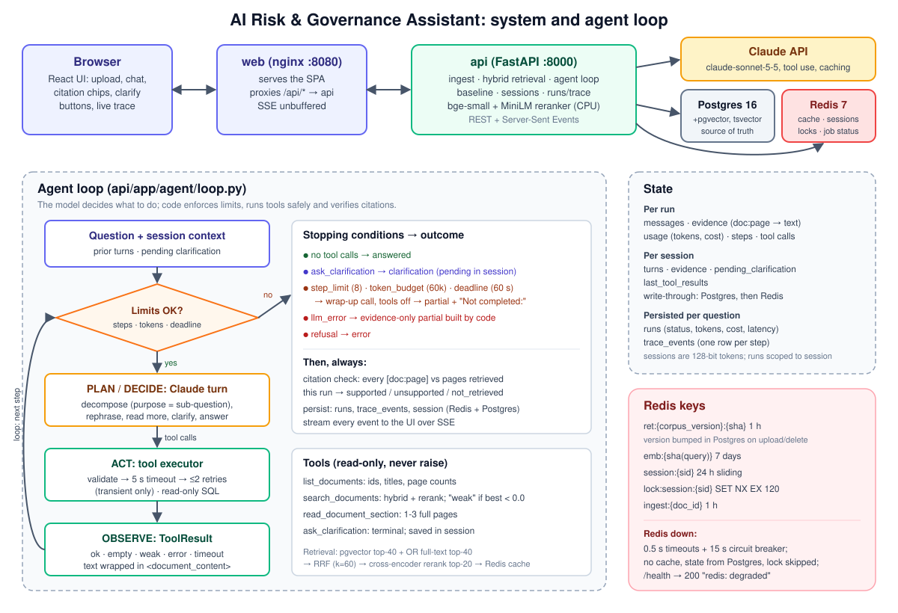
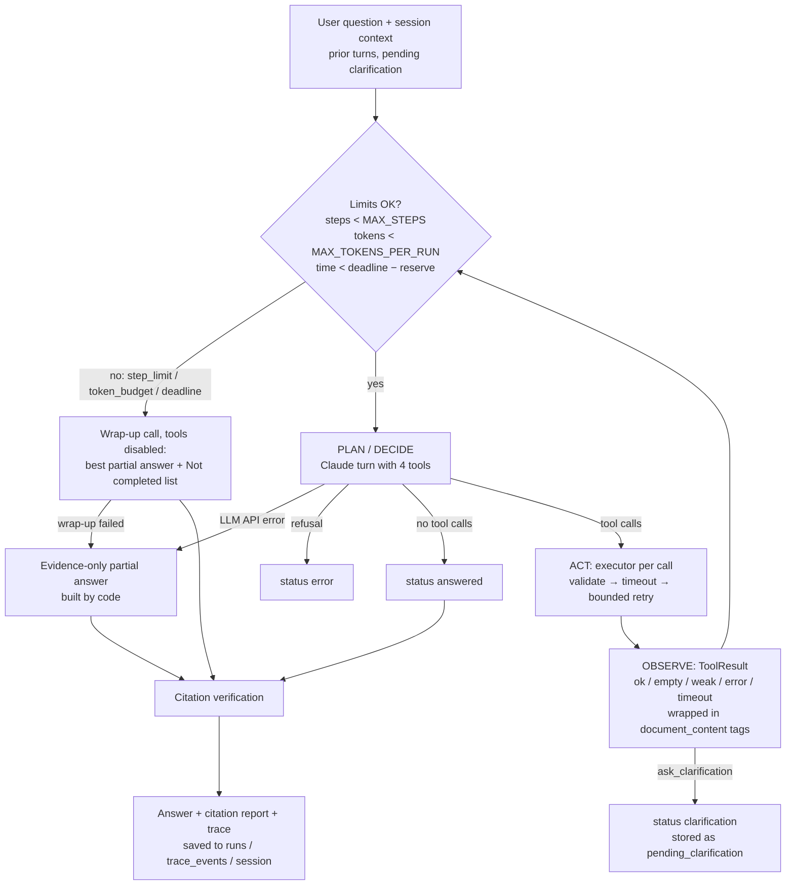

# Architecture



## Components

| Component | Tech | Responsibility |
|---|---|---|
| **web** | React + Vite + TypeScript + Tailwind, served by unprivileged nginx (:8080) | Upload, chat, citation chips, clarification buttons, live execution trace. nginx proxies `/api/*` to the API, so the browser has one origin. |
| **api** | FastAPI (Python 3.12, uv) | REST + Server-Sent Events. Ingest pipeline, hybrid retrieval, the agent loop, the baseline, sessions, run/trace persistence. |
| **Agent loop** | Hand-written loop over the Anthropic tool-use API (`claude-sonnet-5-5`) | Decides which tool to call next; code enforces limits and verifies citations. |
| **Tools** | 4 Pydantic-validated, read-only functions | `list_documents`, `search_documents`, `read_document_section`, `ask_clarification`. |
| **db** | PostgreSQL 16 + pgvector | Documents, pages, chunks + embeddings + `tsvector`, sessions, runs, trace events, corpus version. Source of truth. |
| **redis** | Redis 7 (no persistence, LRU) | Search cache, query-embedding cache, session fast path, per-session run lock, ingest job status. An optimisation: losing it costs latency, not data. |
| **Models (local, CPU)** | fastembed: `BAAI/bge-small-en-v1.5` embeddings, `Xenova/ms-marco-MiniLM-L-6-v2` cross-encoder | Loaded at startup into a `model-cache` volume; `/health` reports `models: loading/ready`. |

## Ingest pipeline

`POST /documents` (multipart, many files) → **register** synchronously (PDF magic-byte and
size check, SHA256 dedupe via `UNIQUE(sha256)`, slug `doc_id`, optional display title) → **process**
in a FastAPI background task:

1. **Parse** with pypdf page by page; page numbers are the 1-based PDF index; hyphenated
   line breaks are re-joined. Full page text goes to `pages` (so the agent can read exact pages).
2. **Chunk**: 300-word windows with 50-word overlap, **never crossing a page**; pages under 20
   words are skipped. 300 words ≈ 400 tokens fits bge-small's **512-token** window; the common
   "800-token" default would be silently truncated at embedding time.
3. **Embed** passages locally (384-d, normalized).
4. **Store** pages and chunks in one transaction (`embedding vector(384)` with an HNSW index,
   `tsv tsvector GENERATED ALWAYS` with a GIN index), mark the document `ready`, and bump
   `corpus_state.version`.

Job status is written to Redis (`ingest:{doc_id}`) and to `documents.status`, so polling works
without Redis. Image-only PDFs fail cleanly ("no extractable text"); OCR is not supported.

## Hybrid retrieval

`retrieval.hybrid_search(query, doc_ids?, top_k)`:

1. **Vector search**: pgvector cosine, top 40 (`hnsw.ef_search = 100`).
2. **Keyword search**: Postgres full-text. `plainto_tsquery` ANDs every word, which rarely
   matches a natural-language question, so it is rewritten to an **OR** query; `ts_rank_cd`
   still ranks chunks matching more terms higher. Top 40.
3. **Reciprocal Rank Fusion** (k = 60) merges the two rankings (not their incomparable scores).
4. **Cross-encoder rerank** of the top 20 fused candidates; final order by rerank score.

**Why the reranker:** bi-encoder cosine scores were compressed. On the first corpus an
off-topic chunk scored 0.69 and a relevant one 0.70, so "nothing relevant found" could not be
detected. The cross-encoder separates them: relevant passages score above 0, out-of-corpus
queries below 0 (health corpus: −7 to −10; governance corpus: −0.18 to −10.85, e.g. *"best
pizza toppings"* −10.85, *"EU AI Act biometric"* −1.59, *"CAIO salary"* −0.18). Hence
`WEAK_SCORE = 0.0`: below it `search_documents` returns status **`weak`** with a hint to
rephrase. Cost: ~1–1.5 s per uncached search on CPU. The margin on policy text is narrower
than on the health corpus, which is a known limitation.

Results are cached in Redis under `ret:{corpus_version}:{sha256(query, doc_ids, top_k)}` for
1 h. A repeated search went from 1,454 ms to 3 ms.

## The agent loop



**Who decides what.** The model decides *what* to do: which sub-questions to search (the
optional `purpose` field makes the decomposition visible in the trace), whether to rephrase a
`weak` result, read neighbouring pages, ask for clarification or answer. Code only enforces
stopping conditions and safety. This is the difference from a fixed retrieve-then-generate
pipeline; the [eval traces](eval-report.md#representative-traces) show each kind of
result-driven change of action.

**Stopping conditions** (checked before every LLM call):

| stop_reason | Trigger | Result |
|---|---|---|
| `answer` | Model replies without tool calls | `answered` |
| `clarification` | Model called `ask_clarification` (terminal tool) | `clarification`, saved in session |
| `step_limit` | `MAX_STEPS` (8) LLM calls used | wrap-up → `partial` |
| `token_budget` | `MAX_TOKENS_PER_RUN` (60,000) used | wrap-up → `partial` |
| `deadline` | `RUN_DEADLINE_S` (60 s) minus a wrap-up reserve (min(15 s, 25%)) | wrap-up → `partial` |
| `llm_error` | Anthropic API failed after the SDK's 2 retries | evidence-only `partial` (or `error` if no evidence) |
| `refusal` | Claude declined | `error` |

The wrap-up call disables tools (`tool_choice: none`) and asks for the best answer from
evidence gathered so far plus a **"Not completed:"** list. If that call fails too, code builds
an answer from the retrieved passages, so the user always gets something useful.

**Claude call settings:** adaptive thinking (default), effort `medium`, automatic prompt
caching (each iteration re-sends the same system prompt, tools and growing history), refusal
fallback `fallbacks: "default"` (the model that answered is recorded per call). Response
content is appended to history unchanged so thinking blocks stay valid.

## Tool contracts and the executor

Every tool takes a Pydantic input model (sent to Claude as JSON Schema) and returns
`ToolResult{status, data, note, citations, terminal}`. Tools **never raise**: bad arguments,
unknown documents or out-of-range pages come back as `status="error"` with a note the model
can act on. See the table in the [README](../README.md#reproducibility-notes).

`tools/executor.py` runs every call:

1. Unknown tool → `error`; Pydantic validation failure → `error` with field messages (never retried).
2. Each attempt runs in a worker thread capped at `TOOL_TIMEOUT_S` (5 s) **and** the remaining run deadline.
3. Only transient failures (timeout, DB connection error, injected fault) are retried, at most
   `TOOL_MAX_RETRIES` (2) times with 0.25 s / 0.5 s backoff. A crash (bug) returns `error` without retry.
4. **Fault injection** (`search_documents:timeout:1`, `:error:3`, …) can be set by `FAULT_INJECT`
   or per request (`fault_inject`), but the API rejects per-request faults unless
   `ALLOW_FAULT_INJECTION=true`. A `FaultPlan` is created per run.

Tools reach data only through `tools/corpus.py`, which runs every query in a
**`SET TRANSACTION READ ONLY`** transaction (an attempted write fails with
`ReadOnlySqlTransaction`, checked by `scripts/edge_cases.sh`), plus `hybrid_search`. They have
no file, network or write access.

## Citation verification

After the answer is generated, `agent/citations.py` checks every `[doc_id:page]` (ranges like
`doc:5-6` and lists like `[a:1, b:2]` are parsed) against `evidence`, the text the tools
returned **in this run**:

| Status | Meaning |
|---|---|
| `not_retrieved` | The page never appeared in a tool result: a fabricated citation (counted as a failure in the eval). |
| `unsupported` | Retrieved, but a number in the cited sentence is not on the cited page(s), or <25% of its content words are. |
| `supported` | Retrieved, numbers present, enough word overlap. |

It is a deliberate **lexical heuristic**, strict about numbers (a wrong figure is the most
likely hallucination in policy text). Numbers that *identify* a source rather than state a
requirement are ignored: dates ("March 28, 2024"), years 1980–2039, document ids ("M-24-10",
"SP 800-218A"), executive orders and section numbers, plus numbers inside the cited doc ids.
These rules came from false positives seen in live runs. Trade-off: a wrong *year* is no longer
caught by the heuristic; it cannot judge paraphrased meaning, which is why the eval also uses an
LLM judge. The UI colours chips green (supported), amber (unsupported) and red (not retrieved).

## Safety

| Concern | Mechanism |
|---|---|
| Prompt injection in documents | All document text is wrapped in `<document_content source="doc:page">`; the system prompt says this content is data and must never be followed. A literal `</document_content` inside a document is escaped so text can't break out of the wrapper. Passages that look like instructions to an AI are flagged in the tool result (`WARNING …`) and in the UI trace. |
| Tools restricted to the corpus | Read-only SQL transactions; no file/network access; doc_id and page validation. |
| Step / token / time limits | `MAX_STEPS`, `MAX_TOKENS_PER_RUN`, `RUN_DEADLINE_S`, `TOOL_TIMEOUT_S`, `TOOL_MAX_RETRIES` in `.env`; useful partial answer on any limit. |
| Session isolation | Session ids are 128-bit random tokens (`secrets.token_urlsafe(16)`); runs are only readable through the session that created them (`GET /sessions/{other}/runs/{id}` → 404); one run per session at a time (Redis lock, 409). |
| Input validation | Question 1–2,000 chars, `mode ∈ {agent, baseline}`, fault spec parsed and rejected if invalid; uploads must be PDFs ≤ 50 MB, ≤ 30 documents. |
| Secrets | `.env` is gitignored; the API key is passed at runtime, never baked into an image; Kubernetes Secret is created from `.env` via stdin. |

## State

**Per run** (in memory, then persisted): messages, `evidence` (`doc:page` → text seen),
usage, steps, tool calls, models used.

**Per session** (`sessions.py`; JSON in Redis `session:{sid}` + Postgres `sessions.state`):

```json
{
  "turns": [{"run_id": 12, "question": "...", "answer": "...", "status": "answered",
             "citations": ["omb-m-25-21:10"]}],
  "pending_clarification": {"original_question": "...", "question": "...", "options": ["..."]},
  "evidence": {"omb-m-25-21:10": "first 300 chars ..."},
  "last_tool_results": [{"tool": "search_documents", "status": "ok", "summary": "..."}]
}
```

A follow-up message is sent to the model with the last 3 turns as context; when a clarification
is pending, it is framed as the reply to that clarification, with the original question.

**Data model** (`api/app/schema.sql`, applied idempotently at startup):

| Table | Purpose |
|---|---|
| `documents` | id (slug), title, filename, sha256 (unique), page/chunk counts, status, error |
| `pages` | full text per (doc_id, page) |
| `chunks` | doc_id, page, chunk_idx, text, `embedding vector(384)` (HNSW), `tsv` (GIN) |
| `corpus_state` | single-row `version`, bumped on every ingest/delete |
| `sessions` | durable session state (JSONB) |
| `runs` | one row per question: mode, status, stop_reason, answer, citation report, steps, tool calls, tokens (in/out/cache read/cache write), cost, latency, model |
| `trace_events` | one row per trace event (LLM call, tool call, tool result, limit, clarification) with step, tool, status, ms, payload |

## Redis keys

| Key | Purpose | TTL / invalidation | If Redis is unavailable |
|---|---|---|---|
| `ret:{corpus_version}:{sha256}` | Search results cache | 1 h. `corpus_version` lives in **Postgres** and is bumped on every upload/delete, so old entries become unreachable immediately and then expire. | Every search computed (≈1–1.5 s instead of ms). |
| `emb:{sha256(query)}` | Query embedding cache | 7 days (embeddings of a fixed model never change). | Embedding recomputed. |
| `session:{sid}` | Session state fast path | 24 h, **sliding** (refreshed on every read). Every write goes to Postgres first. | State read from Postgres (`state_source: postgres`), then Redis is re-populated when it returns. |
| `lock:session:{sid}` | One question per session at a time (`SET NX EX 120`) | Deleted when the run ends; 120 s safety expiry. | Lock skipped (degraded); both runs still recorded. |
| `ingest:{doc_id}` | Upload job status for polling | 1 h | Status read from `documents.status`. |

All calls go through `SafeRedis` with 0.5 s connect/read timeouts and a **circuit breaker**:
after one failure, calls short-circuit for 15 s, so an outage costs at most one slow call per
15 s rather than one per request. `/health` reports `redis: degraded` with HTTP 200 (Postgres
down → 503). A subtle bug found in testing: redis-py returns `None` (not `False`) when an
`SET NX` finds the key, which the wrapper had mistaken for "Redis down", so the lock never
blocked; the wrapper now distinguishes the two, with a test using redis-py semantics.

## Design decisions and trade-offs

| Decision | Why | Trade-off / when to revisit |
|---|---|---|
| **Hand-written agent loop** instead of LangChain/LangGraph | One ~290-line module where every decision point and limit is visible and unit-tested with a scripted fake LLM; one agent needs no graph engine. | No built-in checkpointing or multi-agent graphs; revisit for long-running or multi-agent workflows. |
| **pgvector** instead of a dedicated vector DB | One fewer service; vectors, metadata, full-text and transactions in one place; ~1,100 chunks is tiny. | At millions of chunks or with heavy filtering load, consider a dedicated engine or partitioning. |
| **Local embeddings + cross-encoder reranker** | Free, deterministic, no data leaves the box; hybrid search + reranking closes most of the quality gap. The reranker made "weak result" detectable at all. | Lower quality than large hosted embedders; ~1–1.5 s per uncached search on CPU. |
| **300-word, page-bounded chunks** | Fits bge-small's 512-token window; one citable page per chunk. | Can split tables/lists; mitigated by `read_document_section`. |
| **`corpus_version` in Postgres**, not Redis | Redis can evict keys under memory pressure; losing the version while cached results survive would serve stale results. | One extra cheap query per search. |
| **Write-through session state** (Postgres + Redis) | Redis outage or eviction loses nothing; demonstrated with `docker compose stop redis`. | Two writes per turn. |
| **No Celery**: FastAPI background tasks + Redis/Postgres job status | Enough for ~15 PDFs; one less moving part. | Production: a Redis-backed worker queue so ingest survives API restarts and scales separately. |
| **SSE** for the trace | One-way server→browser stream over plain HTTP, proxied by nginx (`proxy_buffering off`); every event is also written to `trace_events` first, so a dropped connection loses nothing. | `EventSource` can't POST, so the UI reads the stream with `fetch`. |
| **Baseline = same retrieval, model, system prompt and wrapping, tools disabled** | Isolates the value of the loop itself. | It cannot ask for clarification through a tool; it can only answer in text. |
| **Cross-encoder `weak` threshold 0.0** | Calibrated on in- vs out-of-corpus queries on both corpora. | Narrow margin on policy text (−0.18 for an out-of-corpus question). |
